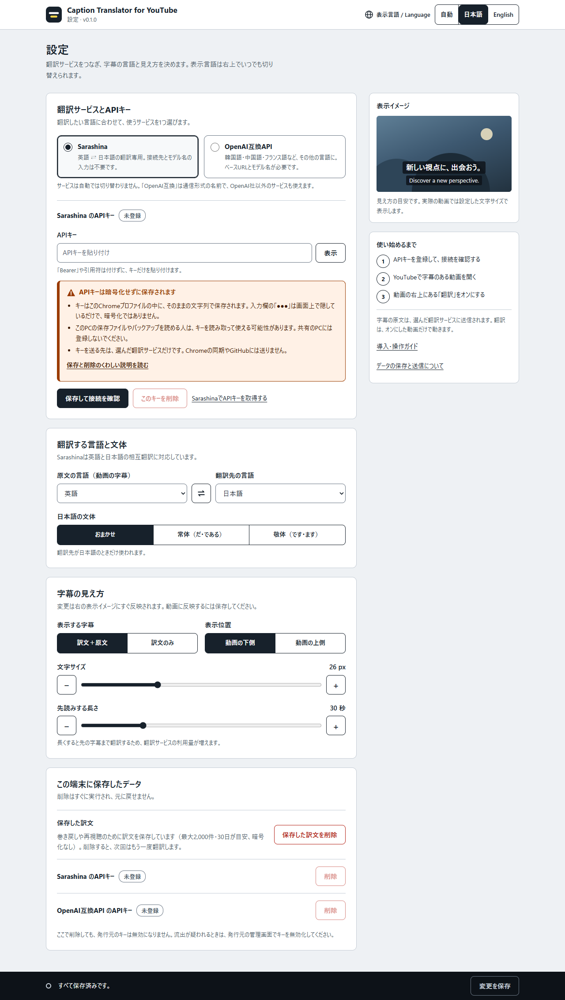

# Caption Translator for YouTube

YouTubeの字幕をAIで翻訳し、再生位置に合わせて動画上に表示するChrome拡張機能です。
初期設定は **Sarashinaで英語 → 日本語**。OpenAI互換のChat Completions APIにも接続できます。



## 翻訳サービスの選び方

| 翻訳したい言語 | 基本的に使うサービス | 必要な設定 |
|---|---|---|
| 英語 → 日本語 / 日本語 → 英語 | **Sarashina** | 自分のSarashina APIキーと翻訳方向。接続先・モデル名の入力は不要 |
| 韓国語・中国語・フランス語などを含む翻訳 | **OpenAI互換API** | 利用サービスのAPIキー・ベースURL・モデル名・翻訳方向 |

日英・英日翻訳にはSarashinaの翻訳専用APIを使う構成です。他の言語では、目的の言語に対応したOpenAI互換サービス・モデルを選びます。
「OpenAI互換」は通信形式を指し、OpenAI社以外の対応サービスも含みます。サービスは設定画面で選択し、自動では切り替わりません。
どちらの場合も、YouTube動画に原文言語の字幕が必要です。

> **APIキーの保存について**
>
> Sarashina・OpenAI互換APIともに、APIキーは利用中のChromeプロファイル内にある拡張専用の `chrome.storage.local` に保存します。**保存時の暗号化は行いません。** Chromeを再起動しても残り、Chromeの同期機能やGitHubには送信しません。
> 端末の保存ファイルやバックアップにアクセスできる人には、キーを読み取られる可能性があります。特に有料の互換APIでは不正利用による料金にも注意してください。入力欄の伏字は保存時の暗号化を意味しません。
> 詳細と削除方法は [APIキーの保存と注意点](docs/PRIVACY.md#apiキーの保存と注意点) を参照してください。

## 使い始める

1. [Releases](https://github.com/sugiyma111-byte/youtube-subtitle-translator/releases) からChrome用ZIPをダウンロードして展開します。
2. Chromeで `chrome://extensions` を開き、右上の「デベロッパーモード」をONにします。
3. 「パッケージ化されていない拡張機能を読み込む」で、**manifest.jsonが入ったフォルダー**を選びます。
4. 拡張を開いて「APIキーを登録」を押し、[Sarashinaの導入手順](docs/USER_GUIDE.md#sarashinaを設定する) に沿ってAPIキーを入力して「保存して接続を確認」を押します。
5. 英語字幕のある通常のYouTube動画を開き、動画右上の「翻訳」スイッチをオンにします。ポップアップの「翻訳を開始」からも始められます。

更新した直後は拡張の更新ボタンを押し、YouTubeページも再読み込みしてください。
詳しくは [導入・操作ガイド](docs/USER_GUIDE.md) を参照してください。
他の言語を翻訳する場合は [OpenAI互換APIの設定手順](docs/USER_GUIDE.md#他の言語をopenai互換apiで翻訳する) を参照してください。

## 機能

- 英語字幕・英語自動字幕の翻訳。Sarashinaでは日本語 → 英語も選択できます。
- 訳文のみ／訳文と原文の併記、文字サイズ、表示位置、文体の設定。
- 先読み、早送り・巻き戻し・一時停止・全画面表示への追従。
- 訳文のローカルキャッシュ、複数タブ共通の送信制限、429への対応。
- OpenAI互換APIの接続先・モデル・言語コードを設定。
- 設定ページの「表示言語 / Language」で自動・日本語・Englishを選択。表示言語はすぐに保存・反映され、翻訳中の動画は止まりません。

翻訳は開始した動画だけで動作し、別の動画に移動すると停止します。
動画上のスイッチと設定ボタンはYouTubeの操作バーと一緒に隠れます。操作するときは動画内でマウスを動かしてください。準備中・送信待ち・エラー時やキーボードでフォーカスしている間は表示を保ちます。

## 対応範囲と制約

対象はデスクトップ版の `https://www.youtube.com/watch` にある字幕付き通常動画です。
音声認識、ライブ配信、Shorts、埋め込み、吹き替え、ピクチャーインピクチャーは対象外です。

YouTubeのページが利用する字幕・文字起こしデータを読み取ります。公式な字幕取得APIではなく、YouTubeの変更で取得できなくなる可能性があります。
字幕本文の直接取得が空の場合は、ページ内の文字起こし取得情報を使い、原文の言語を指定して取得します。
長い段落を分割した際の時刻は文字量による近似です。APIの応答や送信上限によって表示が遅れる場合は、動画を少し停止して先読みを待ってください。

互換APIの対応言語・モデル・料金はサービスごとに異なります。対応形式は `/chat/completions` とテキストの `choices[0].message.content` です。
APIキーは設定画面で登録し、コードには含めません。

## 開発・検証

Node.js 24 / pnpm 11を使用します。

```sh
pnpm install
pnpm check
pnpm exec playwright install chromium
pnpm test:e2e
pnpm zip
```

| コマンド | 内容 |
|---|---|
| pnpm dev | 開発用ビルド |
| pnpm build | .output/chrome-mv3 にChrome用の拡張を生成 |
| pnpm check | 型チェック・単体テスト・本番ビルド |
| pnpm test:e2e | 実ブラウザー上で設定・字幕・再生操作・言語指定を検証 |
| pnpm zip | .output/youtube-subtitle-translator-0.2.1-chrome.zip を生成（名前のバージョン部分は package.json に従う） |

自動テストは実際の翻訳APIを呼びません。実際のYouTubeページでの確認と、ユーザーのキーを使う接続確認は別の検証です。
確認範囲は [検証記録](docs/VALIDATION.md) に記載しています。

## 拡張する

字幕取得 → 文の整理 → 先読み管理 → 翻訳サービス接続 → 時刻に合わせた表示を分離しています。
全体の流れとAPIキーの保存場所は [構成図・設計メモ](docs/ARCHITECTURE.md)、データの扱いは [プライバシー](docs/PRIVACY.md) を参照してください。

仕様参照: [Sarashina Translate](https://docs.sarashina.ai/api-reference/translate)、[レート制限](https://docs.sarashina.ai/rate-limits)、[WXT](https://wxt.dev/)。
