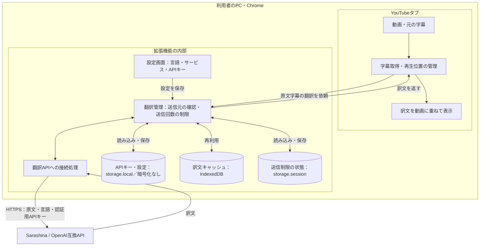

# 設計と拡張方法

## 構成図

現在の構成です。独自の中継サーバーを設けず、利用者のChromeから翻訳サービスへ直接接続します。
GitHubはコードと配布物の保管先で、翻訳処理やAPIキーの保管には使いません。

## 翻訳サービスの方針

- **日英・英日翻訳はSarashinaを基本にします。** 初期値は英語 → 日本語で、専用の `/v1/translate` を利用します。
- 他の言語では、目的の言語に対応するOpenAI互換のChat Completions APIとモデルを設定します。字幕取得・表示と、サービス固有の送受信形式を分離して拡張性を保ちます。
- サービスは設定画面で利用者が選択します。言語による自動切り替えや、失敗時に他社へ送る処理はありません。
- いずれのサービスでも、原文言語の字幕がある動画が対象です。音声認識は行いません。

Sarashina Translateの対応言語とモデル指定不要の仕様は [公式リファレンス](https://docs.sarashina.ai/api-reference/translate) に基づきます（2026年11月17日確認）。

## APIキーの保管方針

**現在は保存時の暗号化を行いません。** キーはサービス別に `chrome.storage.local` へ保存し、解除用パスワードは設けません。
Sarashina用もOpenAI互換API用も同じ方針です。`chrome.storage.session` は送信制限の状態に使用しており、現在のAPIキーの保存先ではありません。

| 仕組み | 保護する範囲 | 保護しない範囲 |
|---|---|---|
| 保存領域を信頼された拡張画面・バックグラウンドに限定 | YouTube上の処理からの保存キーの読み取り | 端末の保存ファイルやバックアップの読み取り |
| 公開設定とキーの分離、送信元の検証 | YouTube側へのAPIキーの返却や外部ページからの設定変更を防ぐ | ブラウザーや端末自体が侵害された場合 |
| API通信にHTTPSを使用 | 通信経路上の盗聴・改ざんへの対策 | 保存済みのキーや訳文ファイルの読み取り |

将来APIキーを暗号化する場合は、図の `storage.local` に保存するキーと、その読み出し処理が変更箇所です。
現状はその保護を備えないため、保存ファイル流出時のキーの不正利用に注意が必要です。詳しくは [データの保存と送信](PRIVACY.md) を参照してください。

## 境界

| 場所 | 責務 |
|---|---|
| src/youtube/bridge.ts / panel.ts | YouTubeのプレーヤー情報と現在の文字起こし取得方式への依存 |
| src/youtube/source.ts / transcript.ts | 字幕取得方法の選択と、時刻付きの共通形式への変換 |
| src/core/captions.ts | 重複除去、文単位の整理、時刻での検索 |
| src/youtube/controller.ts | 先読みと表示。動画の切り替えや停止後に届く古い結果を無視 |
| src/core/providers.ts / settings.ts | 翻訳プロバイダーの共通インターフェース、対応言語と上限 |
| src/background/translator.ts | キーの取得、キャッシュ、全タブ共通の送信制限 |
| src/background/settings-store.ts | 保存値の検証、キーと公開設定の分離 |
| src/ui/overlay.ts | Shadow DOM内で字幕を表示。全画面になるプレーヤーの内側に配置 |

## 翻訳APIを追加する

1. `ProviderId` と `PROVIDERS` に識別子、対応言語、入力上限、送信上限を追加します。
2. `TranslationProvider.translate` を実装します。成功時は訳文、失敗時は共通のエラーコードと必要なら再試行時間を返します。
3. 接続先を固定する場合はmanifestに追加し、任意接続先なら設定時の許可取得を使います。
4. 設定画面に必要な入力だけを追加し、公開設定へキーを含めないようにします。
5. キャッシュキーに、そのサービスのモデル・翻訳に影響する設定を含めます。
6. APIの送信形式、失敗応答、対応言語をテストします。

現在のSarashinaは `/v1/translate`、互換APIは `/chat/completions` を使います。
UIや字幕取得処理は、いずれのレスポンス形式にも依存しません。

## 字幕取得を追加する

`CaptionSource` の出力は `Cue[]`（id / start / end / text）です。時刻は秒で統一します。
音声認識や字幕ファイルを追加するときは、この境界に変換します。

現在の順序は、プレーヤーが公開している字幕URL → ページ内の文字起こしパネル情報 → 言語が確認できる文字起こしDOMです。
パネルの取得にはサイトが持つ動画固有パラメーターとクライアント情報を使い、指定言語を反映します。パラメーターの新規生成やアクセス制限の回避は行いません。
YouTubeの画面・内部APIは安定した契約ではありません。取得ロジックを更新するときは実際のページと合成データの両方で検証してください。

## バックグラウンド停止への対応

MV3のバックグラウンドを常駐させません。訳文はIndexedDB、送信上限の状態はstorage.sessionに保存します。
長い待機をバックグラウンドで維持せず、必要な待ち時間をページ側に返します。
ページ側は次回の送信時に現在の再生位置から対象を選び直します。API通信には20秒のタイムアウトがあります。

## テスト

単体テストは時刻変換、重複字幕、長い段落、API形式、文字数上限、再試行、言語の対応、キャッシュキー、送信制限、送信元の制約を確認します。
結合テストはChromeへ拡張を読み込み、外部翻訳サービスだけをテスト応答へ差し替えます。75秒の小さな合成動画で実際のseekを使います。
YouTube由来の字幕本文や閲覧情報をテストデータとしてコミットしないでください。
